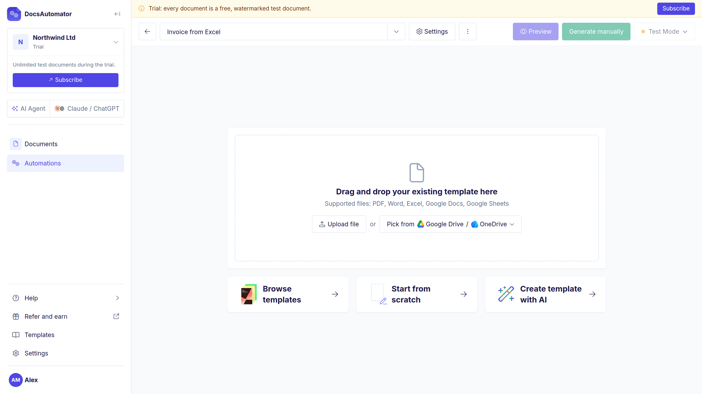
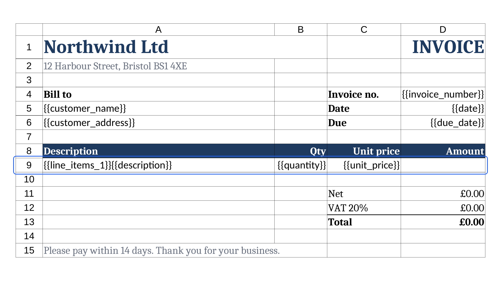
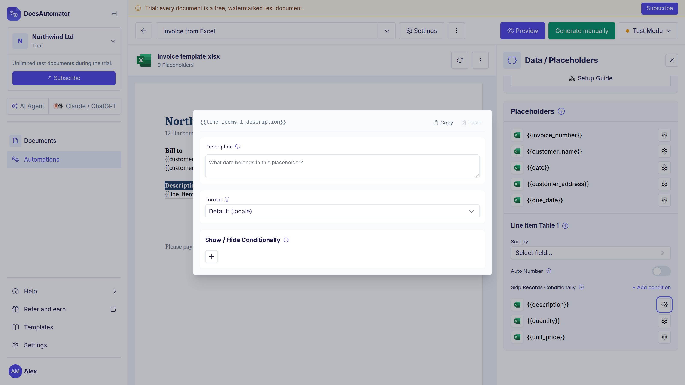
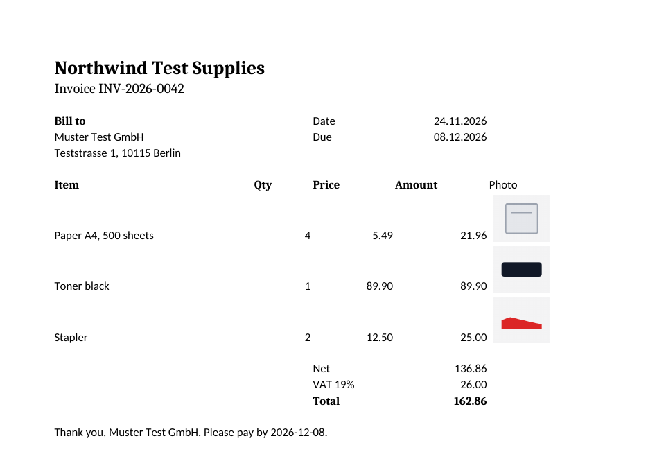
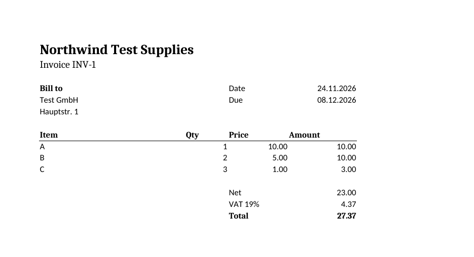
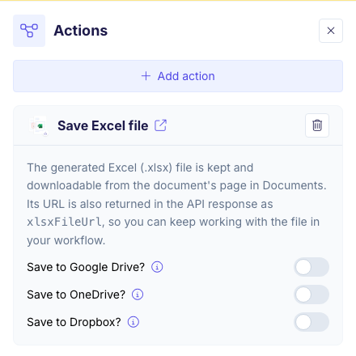

Spreadsheet templates let you keep your document layout in Google Sheets or Excel. You type `{{placeholders}}` into any cell, map them to your data source, and DocsAutomator fills them in and creates a PDF, and an Excel file if you want one. Your formulas, number formats, merged cells, borders and logos stay as you designed them, and the formulas calculate with the new values.

Spreadsheet templates work with every data source, with [line items](/features/line-items), and with [e-invoices](/features/e-invoices).

<Frame>
  
</Frame>

## What works with spreadsheets

This table covers both uploaded Excel files and linked Google Sheets. Where the two differ, the table says so.

| Feature | Works with spreadsheets? | Details |
|---|---|---|
| Placeholders | Yes | In any cell of any tab, alone or inside text. |
| Line items | Yes | One repeating row per line-item table. Several tables per sheet are fine. |
| Line item sorting | Yes | The sort order you set for your data source applies. |
| Nested line items | No | Use one line-item row per table instead. |
| Line item grouping | No | The grouping setting is not offered for spreadsheet templates. |
| Conditional sections | No | To show text only in some cases, use a formula such as `=IF(B5="Yes", "Paid", "")`. |
| Show/hide and Hidden | Yes | They work as in other templates. |
| Format setting (dates, numbers, currency) | Yes | A Format setting prints the value as formatted text. Without one, the cell's own number or date format applies. |
| Number and date style | Yes | Google Sheets use the Sheet's locale. Excel files use the automation's locale. |
| Delete line when empty, Markdown, conditional styles | No | The plain value prints. |
| Fixed images and logos in the sheet | Yes | They stay where you placed them and move down with line items. |
| Images from your data | Yes | An image field alone in its cell prints the image, fitted to the cell. Inside line items, every row gets its own image. |
| E-signatures | Yes | Put the signature tags into the cells where each signature belongs. |
| Acceptance (Accept button instead of a signature) | Yes | |
| Approvals | Yes | |
| PDF output | Yes | Every spreadsheet template creates a PDF. |
| Excel (.xlsx) output | Yes | Add the "Save Excel file" action. The PDF is still created. See [Excel file output](#excel-file-output). |
| Google Sheet output | No | DocsAutomator does not create a new Google Sheet. Use the Excel file, which Google Sheets opens. |
| Save the PDF to Google Drive, OneDrive, Dropbox or a Documents folder | Yes | |
| Send by email | Yes | The PDF is attached. |
| Save the PDF to Airtable, Notion, SmartSuite, ClickUp, HubSpot or a Google Sheets row | Yes | |
| Append or prepend other PDFs | Yes | On plans that include merging PDFs. |
| Test mode and previews | Yes | |
| E-invoices (ZUGFeRD, XRechnung) and Swiss QR-bills | Yes | The e-invoice data comes from your mapped fields. |
| Document name settings | Yes | |
| Data sources | Yes | Airtable, Google Sheets, Notion, ClickUp, SmartSuite, HubSpot, Google Forms, the API, Zapier, Make and n8n. |
| A different template file per API request | No | The API cannot swap in another spreadsheet for one request. |
| The AI Agent and the Claude and ChatGPT connectors | Partly | They can create documents from an automation that has a spreadsheet template. They cannot add, read or change the spreadsheet itself; upload it or link it in the app. |
| Password-protected files | No | Remove the password in Excel or Google Sheets and upload the file again. |
| Google-only functions (`QUERY`, `IMPORTRANGE`, `GOOGLEFINANCE`, `ARRAYFORMULA`, `IMAGE`) | No | They show an error in the PDF. DocsAutomator warns you when it finds one. |

## Add a spreadsheet template

<CardGroup cols={2}>
  <Card title="Google Sheets" icon="table">
    In your automation's template area, choose a Google Sheet from your Google Drive or paste its link. DocsAutomator reads the Sheet each time it creates a document, so changes you make in the Sheet apply right away.
  </Card>
  <Card title="Excel (.xlsx)" icon="file-excel">
    Upload or drop an `.xlsx` file (up to 25 MB). To change the template later, upload the new version.
  </Card>
</CardGroup>

<Frame>
  
</Frame>

To use a Google Sheet, click **Pick from Google Drive** and choose the Sheet, or paste its link below the file list.

<Frame>
  
</Frame>

DocsAutomator lists every placeholder it finds, and you map each one to a field in your data source.

<Frame>
  
</Frame>

## Placeholders

- Type a placeholder into any cell, alone (`{{total}}`) or inside text (`Invoice {{number}} of {{date}}`).
- Placeholders work on every tab. A helper tab, for example a price list or a calculation, can hold placeholders that the invoice tab reads with formulas.
- A cell that holds only one placeholder keeps the cell's own format. A number stays a number, so `#,##0.00 €` formats it and formulas can calculate with it. A date in the form `2026-11-16` becomes a date in a cell with a date format.
- A placeholder inside text prints as text.
- Values that start with `=` print as text. They never run as formulas.
- The placeholder settings **Format**, **Hidden** and **Show/hide** work as in other templates. A Format setting prints the value as formatted text, so it wins over the cell's own format.

## Line items

Put `{{line_items_1}}` into any cell of the row that repeats, and the item fields into the other cells of that row:

| A | B | C | D |
|---|---|---|---|
| `{{line_items_1}}{{description}}` | `{{quantity}}` | `{{unit_price}}` | `=B9*C9` |

<Frame>
  
</Frame>

DocsAutomator adds one row for each item:

- The marker `{{line_items_1}}` prints empty, so you can put it in any cell of the row.
- Formulas in the row are copied to each new row, like copying a row in Excel (`=B9*C9` becomes `=B10*C10`).
- Formulas below move down. A sum over the line-item row, such as `=SUM(D9:D9)` or `=SUM(D9:D10)`, grows to cover every item.
- Merged cells, borders and formats in the row repeat on every new row.
- With no items, the row does not print, and sums over it show 0.
- A template can have several line-item rows (`{{line_items_1}}`, `{{line_items_2}}`). Nested line items are not available in spreadsheet templates.

The item fields show in the placeholder list under **Line Item Table 1**. Map them like the line items of any other template.

<Frame>
  
</Frame>

## Images from your data

An image field puts a picture into the cell where its placeholder sits. Name the placeholder with `image` in it, for example `{{image_photo}}` or `{{product_image}}`, and map it to a field that holds an image link or an attachment.

- **One placeholder per cell.** The image prints only when the placeholder is the whole content of its cell. Inside other text, the image link prints as text, and DocsAutomator warns you when it finds one.
- **Fitted to the cell.** The image fills the cell, or the merged cells, with its proportions kept. Make the row taller or the column wider for a bigger image.
- **Line items:** put the image field into the line-item row, and every item gets its own image. Each row keeps the height you set.
- **Sources:** image links, and attachments from Airtable, Notion, SmartSuite, ClickUp and HubSpot. A list of several links prints the first one.
- **Formats:** PNG, JPG, WebP, GIF (the first frame) and SVG. One image can be up to 60 MB.
- **When an image cannot be loaded,** for example a broken link or a link that does not answer within 10 seconds, its cell stays empty and the document is still created. The run log names the image and the reason.

<Frame>
  
</Frame>

## What prints

DocsAutomator prints one tab of your spreadsheet as a PDF.

- **The first visible tab with content prints.** An empty tab is skipped. Other tabs do not print, but their values still feed your formulas. To keep a tab out of the PDF, hide it in Google Sheets or Excel.
- **Without a print area, every filled cell of that tab prints.**
- **Wide sheets shrink to fit the page width.** DocsAutomator uses the print scaling you set in Excel. Without one, it fits the sheet to one page wide.
- **The paper size** comes from the file. A file without a paper size prints on A4, or on Letter for the United States and Canada.
- **Numbers and dates** use the locale of the Google Sheet, or for an Excel file the locale of the automation. For example, `1.095,99 €` prints in German.

### Print only part of a tab in Excel

Select the cells to print, then choose **Page Layout** → **Print Area** → **Set Print Area**, and save the file. Only those cells print. When line items add rows inside the print area, the print area grows with them, so every item prints.

In the example below, the print area ends at the total. The payment terms below it stay in the file but do not print.

<Frame>
  
</Frame>

## Excel file output

Add the **Save Excel file** action to get the filled-in workbook as an `.xlsx` file next to the PDF.

- **What you get:** the workbook with every tab as you designed it, your formulas, the line-item rows, and the images from your data. The formula results are stored in the file, so previews in email, Google Drive and Quick Look show the totals. Excel also recalculates when you open the file.
- **Where it goes:**
  - It always appears on the document's page in **Documents**, as an **Excel** download.
  - The API response returns its link as `xlsxFileUrl`.
  - It can also go to Google Drive, OneDrive or Dropbox; turn each one on in the action.
- **Email:** in the email action, turn on **Attach the Excel file (.xlsx)**.
- **Write-backs:** choose an attachment field in Airtable, Notion or SmartSuite to receive the Excel file.
- **Signing, acceptance, e-invoices and Swiss QR-bills** work on the PDF only. The Excel file is not signed and holds no e-invoice data.
- Macros and links to files outside the workbook are removed, as they are when you upload a template.

<Frame>
  
</Frame>

## E-invoices

With the [e-invoice add-on](/features/e-invoices), a spreadsheet template creates a ZUGFeRD or XRechnung e-invoice. The e-invoice data comes from your mapped fields, not from the cells. Check that the totals in your sheet and the mapped totals agree, especially when your sheet rounds in its own way.

## What does not work

- **Google-only functions** such as `QUERY`, `IMPORTRANGE`, `GOOGLEFINANCE`, `ARRAYFORMULA` and `IMAGE` show an error in the PDF. DocsAutomator warns you when it finds one. Replace it with a standard function or a fixed value.
- **Conditional sections**, **Delete line when empty**, **Markdown** and **conditional styles** are not available in spreadsheet templates.
