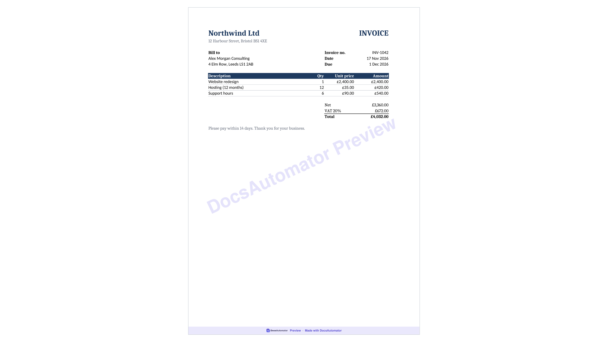
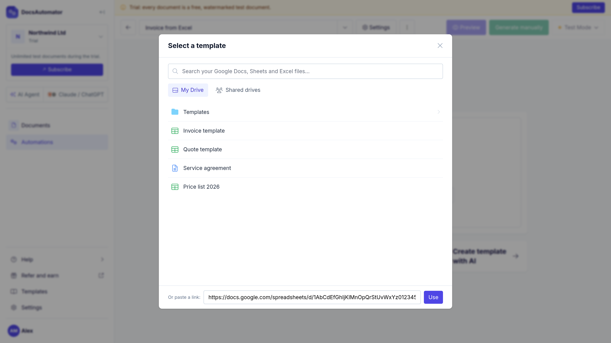
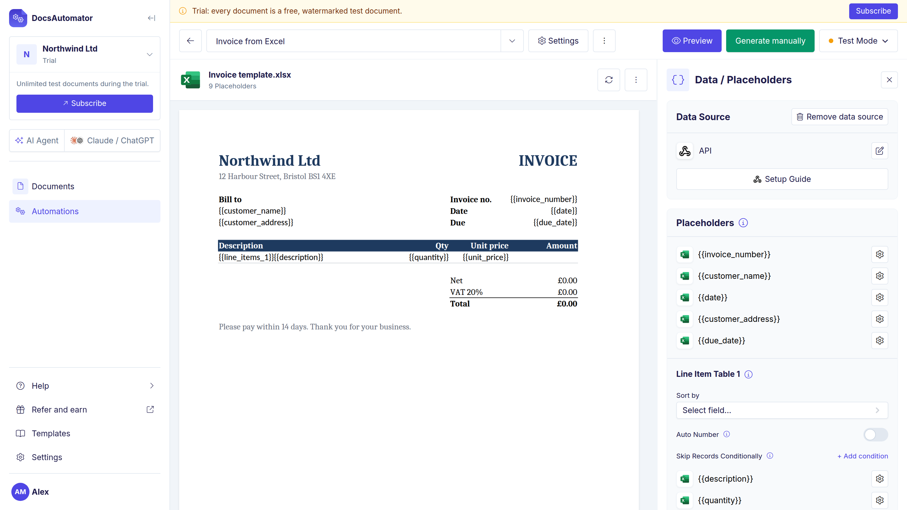

Spreadsheet templates let you keep your document layout in Google Sheets or Excel. You type `{{placeholders}}` into any cell, map them to your data source, and DocsAutomator fills them in and creates a PDF. Your formulas, number formats, merged cells, borders and logos stay as you designed them, and the formulas calculate with the new values.

Spreadsheet templates work with every data source, with [line items](/features/line-items), and with [e-invoices](/features/e-invoices).

<Frame>
  
</Frame>

## Add a spreadsheet template

<CardGroup cols={2}>
  <Card title="Google Sheets" icon="table">
    In your automation's template area, choose a Google Sheet from your Google Drive or paste its link. DocsAutomator reads the Sheet each time it creates a document, so changes you make in the Sheet apply right away.
  </Card>
  <Card title="Excel (.xlsx)" icon="file-excel">
    Upload or drop an `.xlsx` file (up to 25 MB). To change the template later, upload the new version.
  </Card>
</CardGroup>

<Frame>
  
</Frame>

To use a Google Sheet, click **Pick from Google Drive** and choose the Sheet, or paste its link below the file list.

<Frame>
  
</Frame>

DocsAutomator lists every placeholder it finds, and you map each one to a field in your data source.

<Frame>
  
</Frame>

## Placeholders

- Type a placeholder into any cell, alone (`{{total}}`) or inside text (`Invoice {{number}} of {{date}}`).
- Placeholders work on every tab. A helper tab, for example a price list or a calculation, can hold placeholders that the invoice tab reads with formulas.
- A cell that holds only one placeholder keeps the cell's own format. A number stays a number, so `#,##0.00 €` formats it and formulas can calculate with it. A date in the form `2026-11-16` becomes a date in a cell with a date format.
- A placeholder inside text prints as text.
- Values that start with `=` print as text. They never run as formulas.
- The placeholder settings **Format**, **Hidden** and **Show/hide** work as in other templates. A Format setting prints the value as formatted text, so it wins over the cell's own format.

## Line items

Put `{{line_items_1}}` into any cell of the row that repeats, and the item fields into the other cells of that row:

| A | B | C | D |
|---|---|---|---|
| `{{line_items_1}}{{description}}` | `{{quantity}}` | `{{unit_price}}` | `=B9*C9` |

<Frame>
  
</Frame>

DocsAutomator adds one row for each item:

- The marker `{{line_items_1}}` prints empty, so you can put it in any cell of the row.
- Formulas in the row are copied to each new row, like copying a row in Excel (`=B9*C9` becomes `=B10*C10`).
- Formulas below move down. A sum over the line-item row, such as `=SUM(D9:D9)` or `=SUM(D9:D10)`, grows to cover every item.
- Merged cells, borders and formats in the row repeat on every new row.
- With no items, the row does not print, and sums over it show 0.
- A template can have several line-item rows (`{{line_items_1}}`, `{{line_items_2}}`). Nested line items are not available in spreadsheet templates.

The item fields show in the placeholder list under **Line Item Table 1**. Map them like the line items of any other template.

<Frame>
  
</Frame>

## What prints

- **The first visible tab with content prints.** An empty tab is skipped. Hide a tab in Google Sheets or Excel to keep it out of the PDF; its values still feed your formulas.
- **Wide sheets shrink to fit the page width.** DocsAutomator uses the print scaling you set in Excel. Without one, it fits the sheet to one page wide.
- **The paper size** comes from the file. A file without a paper size prints on A4, or on Letter for the United States and Canada.
- **Numbers and dates** use the locale of the Google Sheet, or for an Excel file the locale of the automation. For example, `1.095,99 €` prints in German.

## E-invoices

With the [e-invoice add-on](/features/e-invoices), a spreadsheet template creates a ZUGFeRD or XRechnung e-invoice. The e-invoice data comes from your mapped fields, not from the cells. Check that the totals in your sheet and the mapped totals agree, especially when your sheet rounds in its own way.

## What does not work

- **Google-only functions** such as `QUERY`, `IMPORTRANGE`, `GOOGLEFINANCE`, `ARRAYFORMULA` and `IMAGE` show an error in the PDF. DocsAutomator warns you when it finds one. Replace it with a standard function or a fixed value.
- **Images from your data** cannot be placed into a cell. A fixed logo in the sheet works.
- **Conditional sections**, **Delete line when empty**, **Markdown** and **conditional styles** are not available in spreadsheet templates.
- Spreadsheet templates create PDF files, not spreadsheet files.
