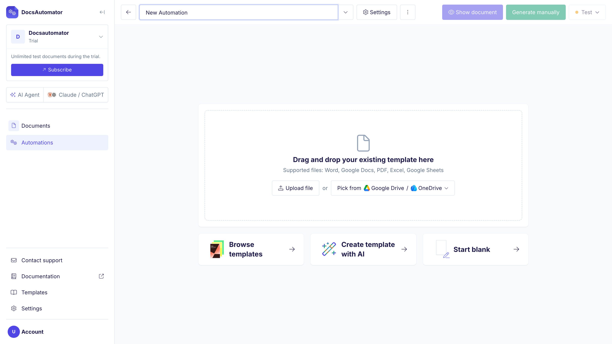

DocsAutomator supports multiple template types so you can pick the best fit for your documents.

<Note>
**New: [AI Template Generator (Beta)](/features/ai-template-generator)** — Don't want to build a template from scratch? Describe what you need and AI creates a complete Google Doc or Word template with proper placeholder syntax, formatting, and layout.
</Note>

<Frame>
  
</Frame>

## Template Types

<CardGroup cols={2}>
  <Card
    title="Google Doc"
    icon="file-lines"
    href="/docsautomator-basics/google-doc-template-guide"
  >
    Create templates directly in Google Docs using `{{ placeholder }}` syntax.
    Best for dynamic content with variable-length sections, line items, and
    conditional content.
  </Card>
  <Card
    title="PDF"
    icon="file-pdf"
    href="/docsautomator-basics/pdf-template-guide"
  >
    Upload an existing PDF and use the visual editor to position data fields on
    top. Best for fixed-layout documents like tax forms, branded designs, or
    government docs.
  </Card>
  <Card
    title="Word (.docx)"
    icon="file-word"
    href="/docsautomator-basics/word-template-guide"
  >
    Use a native Word file as your template with the same `{{ placeholder }}`
    syntax as Google Docs. Stays a `.docx` for its whole life and renders
    straight to PDF. Best when your team designs documents in Microsoft Word.
  </Card>
  <Card
    title="Spreadsheet (Google Sheets or Excel)"
    icon="table"
    href="/docsautomator-basics/spreadsheet-template-guide"
  >
    Use a Google Sheet or an Excel file as your template, with placeholders in
    any cell. Formulas calculate with your data, and line items add rows. Best
    when your invoices or quotes already live in a spreadsheet.
  </Card>
</CardGroup>

## Which Should I Use?

|                                                        | Google Doc | PDF | Word (.docx)       | Spreadsheet        |
| ------------------------------------------------------ | ---------- | --- | ------------------ | ------------------ |
| **Dynamic content** (variable-length text, line items) | Yes        | No  | Yes                | Yes                |
| **Fixed layout** (exact positioning)                   | No         | Yes | No                 | No                 |
| **Line items & repeating rows**                        | Yes        | No  | Yes (single level) | Yes (single level) |
| **Nested (multi-level) line items**                    | Yes        | No  | No                 | No                 |
| **Conditional content** (show/hide sections)           | Yes        | No  | Yes                | No                 |
| **Formulas that calculate with your data**             | No         | No  | No                 | Yes                |
| **E-signatures**                                       | Yes        | Yes | Yes                | Yes                |
| **Pixel-perfect design**                               | No         | Yes | No                 | No                 |
| **Edit in Microsoft Word**                             | No         | No  | Yes                | No                 |

<Note>
  To get one document signed without an automation, use your file or a template
  with [Send for signature](/features/docsautomator-esign/send-for-signature).
</Note>

<Tip>
  If you're not sure, start with a **Google Doc template** — it's the most
  flexible option and supports all of DocsAutomator's advanced features like
  line items, conditional content, and e-signatures.
</Tip>
