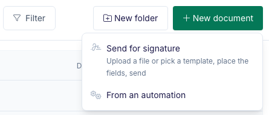
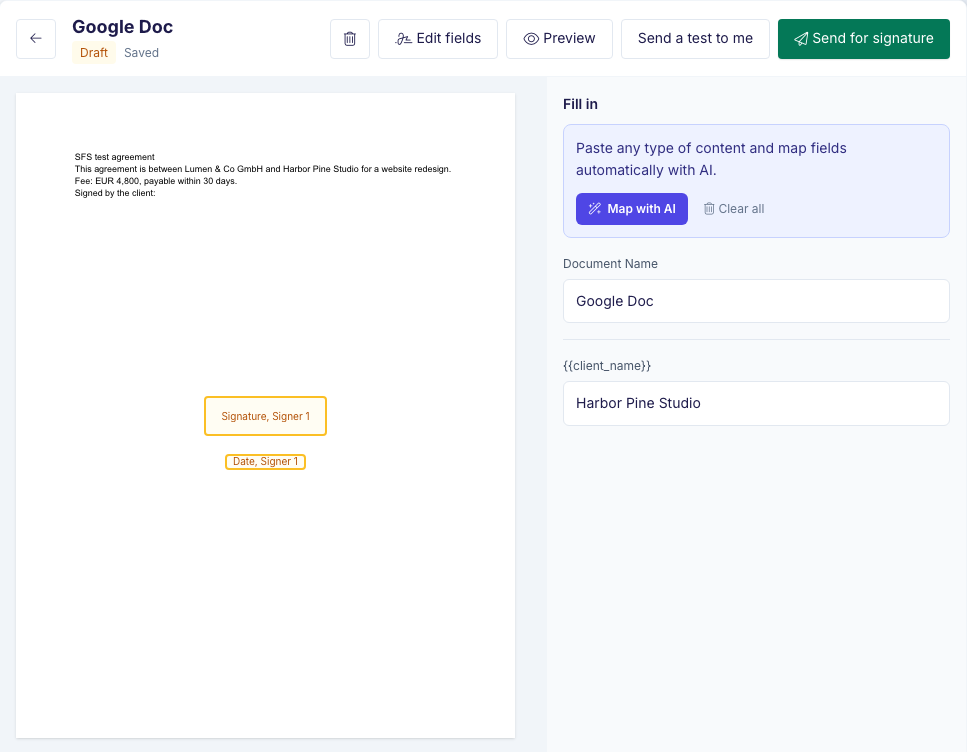
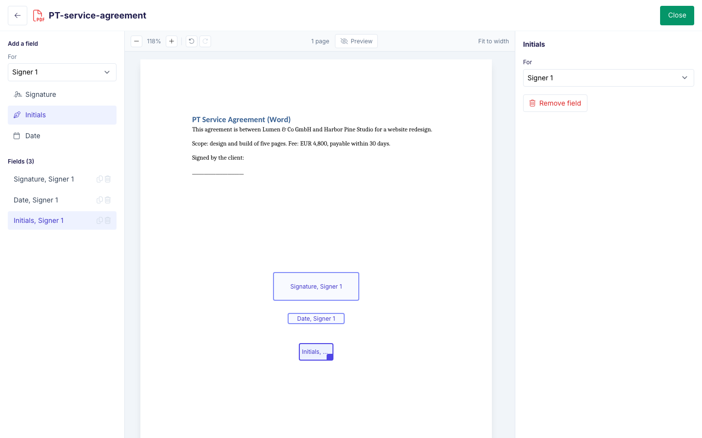
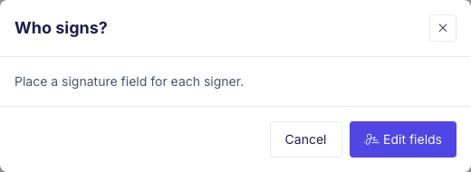

Use **Send for signature** to get one document signed without setting up an automation.

## Start a document

Go to **Documents**, click **New document** and choose **Send for signature**. On a template's page, you can also click **Send for signature**.

<Frame>
  
</Frame>

## Choose the document

Pick the document people will sign:

- **Upload file**: a PDF or Word file from your computer.
- **Pick from Google Drive or OneDrive**: a file from your connected account.
- **Browse templates**: one of your own templates under My Templates, or a template from the gallery.

Files you upload or pick from Google Drive or OneDrive are saved under My Templates, so you can use them again.

<Frame>
  
</Frame>

## Fill in the values

If the template has placeholders, the panel on the right lists them under **Fill in**. Type a value for each one, and set the document name. The document on the left shows your values.

<Frame>
  
</Frame>

## Place the fields

Click **Edit fields**. For each signer, choose the signer under **For** and add the fields they fill in:

- **Signature**
- **Initials**
- **Date**

Drag each field to its place on the page. Click **Close** when you are done.

**Every signer needs a Signature field.**

If your template already has signature tags such as `{{esign.signature_1}}`, the fields are placed for you. If you used this template before, your fields are already in place. Check that they still fit.

<Frame>
  
</Frame>

## Who signs?

Click **Send for signature**. The **Who signs?** dialog lists each signer you placed fields for. Enter a name and an email for each, then click **Send**. Each signer gets an email with a link to sign.

If a signer has no Signature field, the dialog says "Place a signature field for each signer." Click **Edit fields** to add one.

<Frame>
  
</Frame>

## Check before you send

- **Preview** shows what the signers will see. It sends nothing.
- **Send a test to me** sends the signing email to you only. The test is free, carries a watermark and does not count toward your plan.

## Drafts

Your document saves as a draft from your first change, so there is no save button.

Drafts you have not sent are listed at the top of **Documents**. Click **Continue** to pick up where you left off, or **Delete** to remove the draft. Drafts are deleted 30 days after their last change.

<Frame>
  
</Frame>

## Trials and your plan

- During a trial, documents carry a watermark.
- A document you send for signature counts as one document in your plan, however many people sign it.

## Send this often?

After you send, the document's page shows "Send this often? Fill it from your records automatically." Click **Set up an automation** to create an automation with the same template.

<Frame>
  
</Frame>

## From DocsAutomator Agent, Claude or ChatGPT

Ask DocsAutomator Agent, or your AI client connected through [MCP](/integrations-api/docsautomator-mcp), to get a document signed. It follows the same steps and gives you a link to the draft, where you can check or move the fields. Before anything is sent, it asks you to confirm the recipients.

For MCP clients, `create_document` takes `templateId` in place of `automationId`:

- `templateId`: the template to send. `search` with `in: "my_templates"` lists your templates, and `in: "templates"` lists the gallery.
- `data`: the placeholder values.
- `recipients`: one entry per signer, for example `[{ "signer": 1, "email": "anna@acme.com", "name": "Anna Weber" }]`.
- `fields`: where each signer signs, placed by text printed in the document: `[{ signer, type, anchor, offsetX?, offsetY? }]`.
  - `type`: `signature`, `initials` or `date`.
  - `anchor`: text in the document, for example `"Client signature"`. The field goes right after the first match.
  - `offsetX` and `offsetY`: points to move the field right and down.
- `mode`: `preview`, `test` or `live`. Without a mode, the document goes out as a test.

```json
{
  "templateId": "6650a1b2c3d4e5f6a7b8c9d0",
  "data": { "client_name": "Harbor Pine Studio" },
  "recipients": [{ "signer": 1, "email": "anna@acme.com", "name": "Anna Weber" }],
  "fields": [
    { "signer": 1, "type": "signature", "anchor": "Signed by the client:", "offsetY": 20 },
    { "signer": 1, "type": "date", "anchor": "Date:" }
  ],
  "mode": "live"
}
```

Every signer needs a signature field, from `fields` or from a `{{esign.signature_1}}` tag in the template. Without one, nothing is sent. If an anchor is not in the document, the call fails with an error that names the anchor.

The answer includes `draftUrl`, the link to the draft in DocsAutomator, and the page, position and number of matches of each anchor.

<Note>
The REST API sends documents from an automation, with `automationId`. See [Create document](/api-reference/documents/create-from-api).
</Note>
