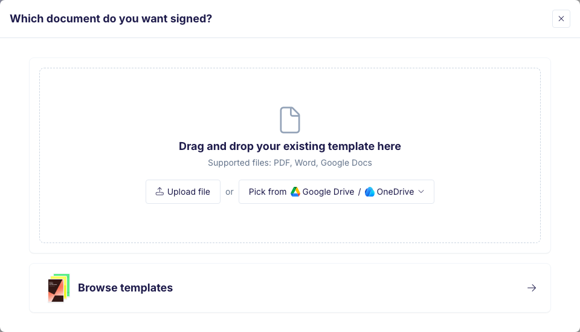
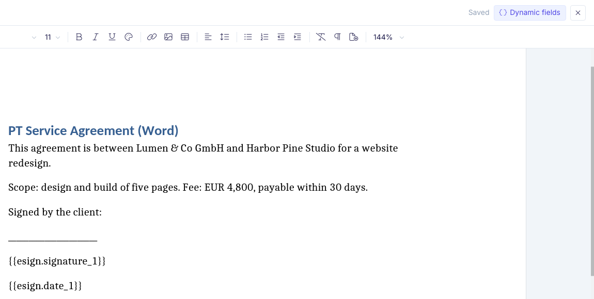
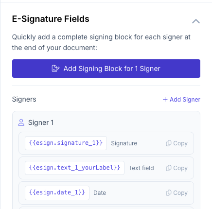
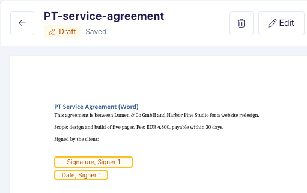
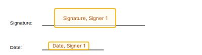
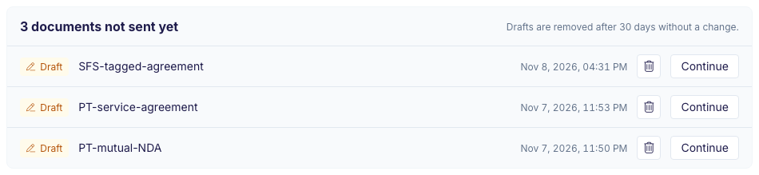
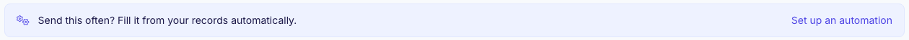

Use **Send for signature** to get one document signed without setting up an automation.

## Start a document

Go to **Documents**, click **New document** and choose **Send for signature**. On a template's page, you can also click **Send for signature**.

## Choose the document

Pick the document people will sign:

- **Upload file**: a PDF or Word file from your computer.
- **Pick from Google Drive or OneDrive**: a file from your connected account.
- **Browse templates**: one of your own templates under My Templates, or a template from the gallery.

Files you upload or pick from Google Drive or OneDrive are saved under My Templates, so you can use them again.

<Frame>
  
</Frame>

## Fill in the values

If the template has placeholders, the panel on the right lists them. Type a value for each one, and set the **Document Name**. The document on the left shows your values.

## Add the signing fields

Click **Edit** on the send page. What opens depends on the file.

### Word and Google Docs

The fields come from signing tags in the document, such as `{{esign.signature_1}}` and `{{esign.date_1}}`. The number is the signer: `_1` is signer 1. Each field sits where its tag is, so it moves with the text.

**Edit** opens:

- **Word**: the Word editor. Click where the signer signs, then click **Dynamic fields**, choose **E-signature field**, pick the **Signer** and click **Signature** or **Date**.
- **Google Docs**: your Google Doc in the editor, with **E-Signature Fields** on the right. Click **Add Signing Block for 1 Signer** to add a signing block at the end of the document. For more signers, click **Add Signer** first. Or click **Copy** next to a tag and paste it where the signer signs.

<Frame>
  
</Frame>

<Frame>
  
</Frame>

When you close the editor, the fields show at the tags.

<Frame>
  
</Frame>

**Edit** changes the template itself. A Google Doc is shared with its automations, so your edits change them too. A Word file is copied into each automation, so your edits here change no automation.

### PDF

**Edit** opens the PDF editor. Under **Add a field**, click **Signature** and drag the field to its place. Add **Initials** or a **Date** the same way. For another signer, choose **+ New signer** under **For**. Click **Close** when you are done.

If you placed fields on this PDF before, they are already in place. Check that they still fit.

<Frame>
  
</Frame>

### Every signer needs a signature field

For a Word file or a Google Doc, that is a signature tag such as `{{esign.signature_1}}`. For a PDF, it is a placed **Signature** field. Until every signer has one, the panel on the right shows this message and an **Edit** button, and you cannot send:

- Word and Google Docs: "Add a signature field in the document where each signer signs."
- PDF: "Place a signature field for each signer."

## Who signs?

Click **Send for signature**. The **Who signs?** dialog lists each signer who has fields in the document. Enter a name and an email for each, then click **Send**. Each signer gets an email with a link to sign.

If a signer has no signature field, the dialog shows the same message, with **Edit** in place of **Send**.

## Check before you send

- **Preview** shows what the signers will see. It sends nothing.
- **Send a test to me** sends the signing email to you only. The test is free, carries a watermark and does not count toward your plan. During a trial, this button is hidden.

## Drafts

Your document saves as a draft from your first change, so there is no save button.

Drafts you have not sent are listed at the top of **Documents**. Click **Continue** to pick up where you left off, or **Delete** to remove the draft. Drafts are deleted 30 days after their last change.

<Frame>
  
</Frame>

## Trials and your plan

- During a trial, documents carry a watermark.
- A document you send for signature counts as one document in your plan, however many people sign it.

## Send this often?

After you send, the document's page shows "Send this often? Fill it from your records automatically." Click **Set up an automation** to create an automation with the same template. Signing is on in the new automation, with the same signers. For a PDF, your placed fields go into the automation too.

If a Word file does not have a signature tag for every signer, signing stays off, and the automation opens with the note "Add a signature tag in the template to turn on signing."

<Frame>
  
</Frame>

## From DocsAutomator Agent, Claude or ChatGPT

Ask DocsAutomator Agent, or your AI client connected through [MCP](/integrations-api/docsautomator-mcp), to get a document signed. Before anything is sent, it asks you to confirm the recipients. It gives you a link to the draft in DocsAutomator.

- **Word and Google Docs**: the fields come from the signing tags in the document. If a signer has no signature tag, nothing is sent. You get the link to the draft, so you can add the tag with **Edit** and send from there.
- **PDF**: the fields are placed by text printed in the document.

For MCP clients, `create_document` takes `templateId` in place of `automationId`:

- `templateId`: the template to send. `search` with `in: "my_templates"` lists your templates, and `in: "templates"` lists the gallery. A gallery template is a Word file, so it signs at its tags.
- `data`: the placeholder values.
- `recipients`: one entry per signer, for example `[{ "signer": 1, "email": "anna@acme.com", "name": "Anna Weber" }]`.
- `fields` (PDF only): where each signer signs, placed by text printed in the document: `[{ signer, type, anchor, offsetX?, offsetY? }]`. For a Word file or a Google Doc, leave `fields` out: the tags in the document are the fields. If you pass it, the call is refused with an error that says so.
  - `type`: `signature`, `initials` or `date`.
  - `anchor`: text in the document, for example `"Client signature"`. The field goes right after the first match.
  - `offsetX` and `offsetY`: points to move the field right and down.
- `mode`: `preview`, `test` or `live`. Without a mode, the document goes out as a test.

This example sends a PDF:

```json
{
  "templateId": "6650a1b2c3d4e5f6a7b8c9d0",
  "data": { "client_name": "Harbor Pine Studio" },
  "recipients": [{ "signer": 1, "email": "anna@acme.com", "name": "Anna Weber" }],
  "fields": [
    { "signer": 1, "type": "signature", "anchor": "Signed by the client:", "offsetY": 20 },
    { "signer": 1, "type": "date", "anchor": "Date:" }
  ],
  "mode": "live"
}
```

If a signer has no signature field, nothing is sent. If an anchor is not in the PDF, the call fails with an error that names the anchor.

The answer includes `draftUrl`, the link to the draft in DocsAutomator. For a PDF, it also has the page, position and number of matches of each anchor.

<Note>
The REST API sends documents from an automation, with `automationId`. See [Create document](/api-reference/documents/create-from-api).
</Note>
