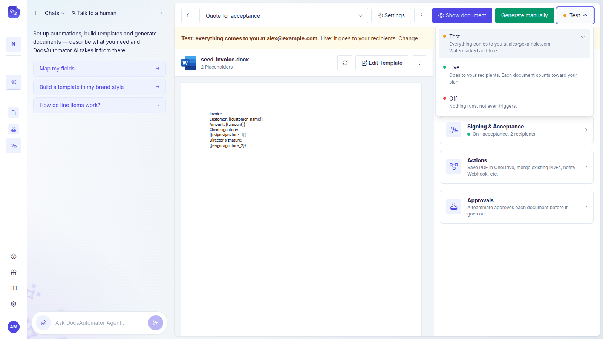
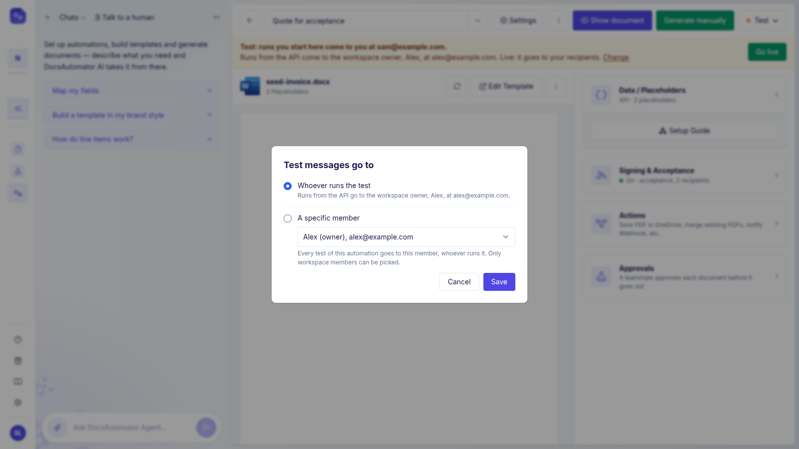
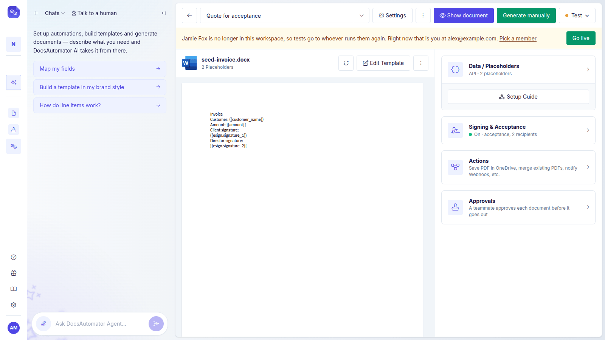
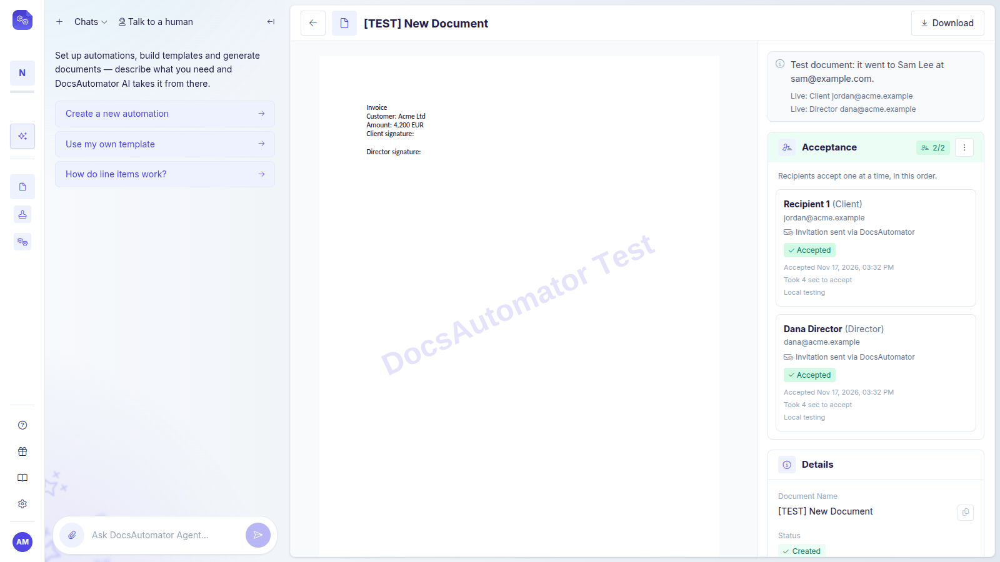

Generate an unlimited amount of previews without wasting credits. Document preview generation is a critical testing feature in DocsAutomator, allowing you to verify templates and integration functionality before deploying to production.

## Preview Methods

<Tabs>
  <Tab title="From Automation Interface">
    Once your automation has a template and a connected data source, click the **Preview** button in the top bar to open a preview of your document.

    **For Airtable and ClickUp integrations:**
    - Map specific records or tasks from your selected bases, tables, spaces, or lists

    **For other integrations:**
    - Use the mapping interface to associate data with placeholders in your template
  </Tab>
  <Tab title="Test Mode for Entire Automation">
    Set the automation's status to **Test Mode** to test the complete workflow:

    <Frame>
      
    </Frame>

    - Applies a watermark to generated PDFs
    - Consumes zero document credits
    - If "Save Google Doc" is enabled, preserves the Google Doc with a "TEST: NOT FOR DISTRIBUTION" header
    - If "Save PDF in Google Drive" is enabled, saves the watermarked PDF to your Drive folder
    - If URL writeback fields are configured, writes Google Doc URL and PDF Drive URL back to your data source
    - Document names are prefixed with `[TEST]` for easy identification
    - Every email, signing, acceptance and approval request goes to the person testing, never to your recipients

    <Info>
    Test: everything comes to you. Live: it goes to your client. A test you start in the app comes to you. A run that names a team member in `actingUserEmail` comes to that member, if they belong to the workspace. Other runs from Airtable buttons, Zapier, Make, webhooks, polling or the API come to the workspace owner. A member picked under **Test messages go to** in the automation settings gets every test of that automation instead. Only workspace members can be picked.
    </Info>

    The bar at the top of the automation names the address your tests go to.

    <Frame>
      
    </Frame>

    To send every test of this automation to one member, click **Change** on the bar and pick the member under **Test messages go to**.

    <Frame>
      
    </Frame>

    If the picked member leaves the workspace, tests go to whoever runs them again, and the bar says so.

    <Frame>
      
    </Frame>

    The document page of a test says where the test went and who a live run would reach.

    <Frame>
      
    </Frame>

    <Tip>
    Use this mode to test your full automation from start to finish, including Drive saves and data source writebacks, before going live.
    </Tip>
  </Tab>
</Tabs>

## Key Benefits

<CardGroup cols={2}>
  <Card title="Unlimited Testing" icon="infinity">
    Test as many times as needed without using credits
  </Card>
  <Card title="Template Validation" icon="check-circle">
    Verify placeholder mapping and formatting
  </Card>
  <Card title="Integration Testing" icon="plug">
    Test data source connections before production
  </Card>
  <Card title="Risk-Free Development" icon="shield">
    Iterate on designs without cost concerns
  </Card>
</CardGroup>

## Test Mode vs Production

| Feature | Test Mode | Production Mode |
|---------|--------------|-----------------|
| PDF Watermark | Yes | No |
| Google Doc Header (saved Google Doc only) | "TEST: NOT FOR DISTRIBUTION" | None |
| Document Name Prefix | `[TEST]` | None |
| Credit Usage | None | 1 per document |
| PDF Quality | Full | Full |
| Save PDF to Google Drive | Yes (if configured) | Yes (if configured) |
| Save Google Doc | Yes (if configured) | Yes (if configured) |
| URL Writeback to Data Source | Yes (if configured) | Yes (if configured) |
| Emails, signing, acceptance and approval requests | To the person testing | To your recipients |

## Best Practices

<AccordionGroup>
  <Accordion title="Test all placeholder variations">
    Try different data values to ensure your template handles various scenarios correctly.
  </Accordion>
  <Accordion title="Check conditional sections">
    Verify that conditional show/hide and sections work with different data combinations.
  </Accordion>
  <Accordion title="Review line items">
    Test with different numbers of line items to ensure tables expand correctly.
  </Accordion>
  <Accordion title="Validate formatting">
    Check dates, numbers, and currency formatting match your expectations.
  </Accordion>
</AccordionGroup>
