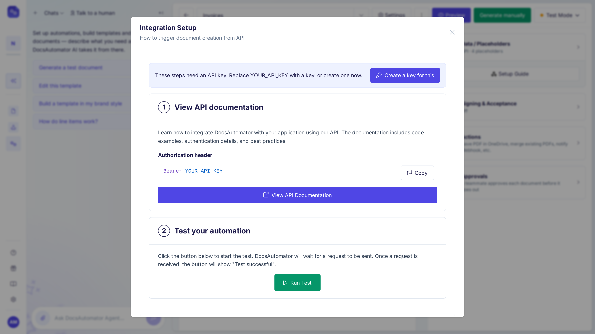

DocsAutomator offers a REST API to create documents programmatically, manage automations, and control e-signature workflows. Use it to add document generation into any software.

## Getting Started

<Steps>
  <Step title="Create an API key">
    Create a key in [Settings > API keys](https://app.docsautomator.co/settings/workspace/api), or click **Create a key for this** in the automation's setup guide. Copy it when you create it, because it is shown once. See [API keys](/more/finding-your-api-key).

    <Frame caption="The API setup guide sends the key in the Authorization header.">
      
    </Frame>
  </Step>
  <Step title="Authenticate">
    Pass your API key as a bearer token in the `Authorization` header:
    ```bash
    Authorization: Bearer YOUR_API_KEY
    ```
  </Step>
  <Step title="Create a document">
    ```bash
    curl -X POST https://api.docsautomator.co/createDocument \
      -H "Authorization: Bearer YOUR_API_KEY" \
      -H "Content-Type: application/json" \
      -d '{
        "docId": "YOUR_AUTOMATION_ID",
        "data": {
          "customer_name": "Acme Corp",
          "invoice_date": "2025-01-15",
          "total": "$1,500.00"
        }
      }'
    ```
  </Step>
</Steps>

## Formatting Values

Send values raw (`1234.5`, `2026-06-30`, `true`) and let DocsAutomator render them — open the gear icon next to a placeholder and pick a **Format**: currency, decimals, percent, date styles, or custom true/false labels. Conditions and calculations keep evaluating the raw value; formatting is display-only. See [Format Values](/features/advanced-placeholder-options/format-values).

## Placeholders & Descriptions

List an automation's placeholders — and the description of each — before you build a `createDocument` payload:

```bash
curl "https://api.docsautomator.co/listPlaceholdersV2?automationId=YOUR_AUTOMATION_ID" \
  -H "Authorization: Bearer YOUR_API_KEY"
```

```json
{
  "placeholders": {
    "main": ["client_name", "fee", "start_date"],
    "line_items_1": ["description", "amount"]
  },
  "descriptions": {
    "client_name": "Full legal name of the customer, from the CRM contact record",
    "fee": "Total contract fee in EUR, numeric, no currency symbol"
  }
}
```

`descriptions` appears when per-placeholder descriptions are set. They tell an API client (or an AI agent) what data belongs in each placeholder. Set them in the app via the gear icon next to a mapping, or via the API:

```bash
curl -X PUT "https://api.docsautomator.co/updateAutomation?automationId=YOUR_AUTOMATION_ID" \
  -H "Authorization: Bearer YOUR_API_KEY" \
  -H "Content-Type: application/json" \
  -d '{"options": {"placeholderDescriptions": {"fee": "Total contract fee in EUR, numeric"}}}'
```

<Warning>
`options.placeholderDescriptions` replaces the whole map: read the current map first and send it back with your changes. Each description is a string of at most 2,000 characters.
</Warning>

Automations also carry their own `description` — what the automation is for and what data it needs. `GET /automations` and `GET /automation` return it; set it with `{"description": "..."}` on `updateAutomation`, or in the app under **Automation Settings**.

## New automations start in test mode

Every automation you create with `createAutomation`, and every copy made with `duplicateAutomation`, starts in test mode (`isPreview: true`). Test documents are watermarked and free. In test mode, every email, signing, acceptance and approval request goes to the person testing, never to your recipients. With an API key, that is the team member named in `actingUserEmail` if they belong to the workspace, and otherwise the workspace owner. The `createDocument` response says where it went in `testRecipient`, and lists who a live run would reach in `recipients`.

To send every test of an automation to one member instead, set `testRecipient` to that member's email with `updateAutomation` (`""` goes back to the default). Only workspace members can be picked; any other address is refused with `TEST_RECIPIENT_NOT_MEMBER`. A picked member gets every test of the automation, whoever runs it. `GET /automation` returns the current choice as an object in `testRecipient`: `mode` is `"member"` for a picked member and `"runner"` for the default, `name` and `email` name the picked member (or, for the default, the workspace owner), and `fallback` is `true` when the picked member has left the workspace and tests use the default again.

When the automation is ready, switch it to live:

```bash
curl -X PUT "https://api.docsautomator.co/updateAutomation?automationId=YOUR_AUTOMATION_ID" \
  -H "Authorization: Bearer YOUR_API_KEY" \
  -H "Content-Type: application/json" \
  -d '{"isPreview": false}'
```

From then on, `createDocument` makes live documents that count in your plan. Going live needs a confirmed account email. You can also switch an automation to live in the app.

## Full API Reference

For complete endpoint documentation with an interactive playground, see the **[API Reference](/api-reference/introduction)** tab.

<CardGroup cols={2}>
  <Card title="Documents" icon="file-pdf" href="/api-reference/introduction">
    Create documents, check job status, view queue stats
  </Card>
  <Card title="Automations" icon="gear" href="/api-reference/introduction">
    List, create, update, delete, and duplicate automations
  </Card>
  <Card title="Templates" icon="file-code" href="/api-reference/introduction">
    List placeholders, duplicate templates
  </Card>
  <Card title="E-Signatures" icon="signature" href="/api-reference/introduction">
    Manage signing sessions, links, and audit trails
  </Card>
</CardGroup>

## Need Help?

<CardGroup cols={2}>
  <Card title="In-App Chat" icon="comments">
    Contact support via the in-app chat feature
  </Card>
  <Card title="Email Support" icon="envelope" href="mailto:support@docsautomator.co">
    Reach out at support@docsautomator.co
  </Card>
</CardGroup>
