DocsAutomator connects to HubSpot directly. You create a document from a deal, ticket, contact, company or custom object with a button on the record or with a step in a HubSpot workflow. The PDF comes back to the record as a note. With signing or acceptance on, the signed PDF comes back as well.

<Frame>
  <iframe
    width="100%"
    height="400"
    src="https://www.youtube.com/embed/vNobVxFmi2M"
    title="DocsAutomator for HubSpot: Create, Sign and Close Deals Automatically"
    frameBorder="0"
    allow="accelerometer; autoplay; clipboard-write; encrypted-media; gyroscope; picture-in-picture"
    allowFullScreen
  />
</Frame>

<Tip>
**Launch offer: three months free**

Connect HubSpot and create at least five documents from it by Friday, 4 December 2026, and we credit three months of your plan. New to DocsAutomator? The same applies once you subscribe.
</Tip>

<Info>
New to DocsAutomator? Start with the [Quickstart Guide](/docsautomator-basics/quickstart-guide).
</Info>

## What you need

- A HubSpot user with Super Admin rights connects HubSpot for the whole team.
- The button on the record works on every HubSpot plan.
- Workflows need HubSpot Professional or Enterprise. Custom objects need HubSpot Enterprise.

## Connect HubSpot

1. In DocsAutomator, open **Settings**, then **Integrations**, and click **Connect** on the HubSpot card.

   <Frame>
     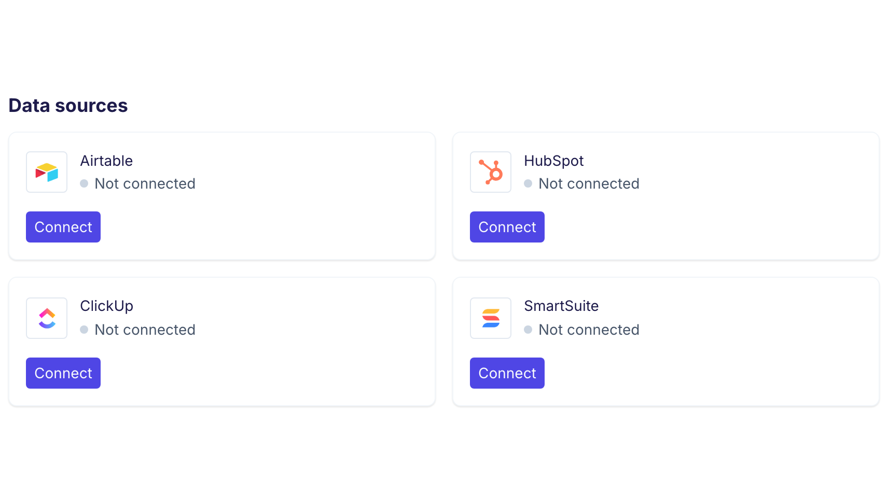
   </Frame>

2. Choose your HubSpot account, check the permissions and click **Connect app**. Until HubSpot finishes its review of the app, HubSpot shows a note that the app is unverified and asks you to type **I accept the risk** before it connects.

   <Frame>
     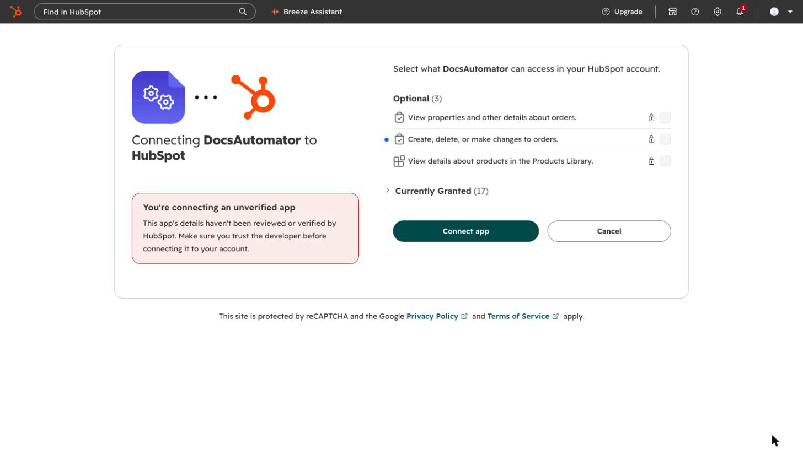
   </Frame>

Connecting installs the DocsAutomator app in your HubSpot account. One HubSpot account connects to one DocsAutomator workspace. If another workspace already uses it, disconnect it there first.

<Frame>
  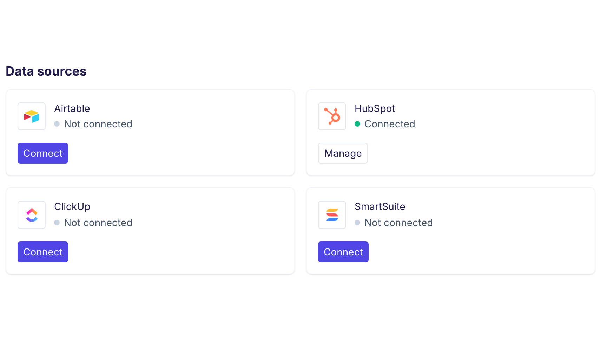
</Frame>

## Create an automation

1. Create an automation and choose **HubSpot** as the data source.
2. Under **Create documents from**, choose the record type: deals, tickets, contacts, companies or one of your custom objects.

<Frame>
  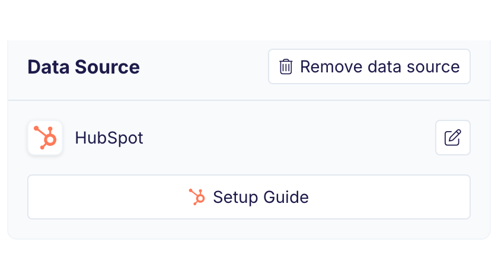
</Frame>

<Frame>
  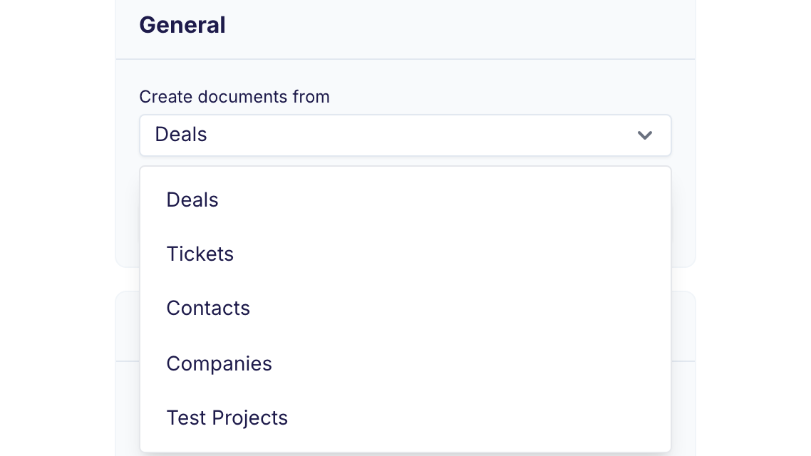
</Frame>

3. Map the placeholders of your template to HubSpot properties. A placeholder whose name matches a property, such as `{{deal_dealname}}` or `{{contact_email}}`, needs no mapping.
4. For a table, use `{{line_items_1}}`. A deal's line items fill it by themselves. You can also fill a table with associated records, such as a company's deals.

<Frame>
  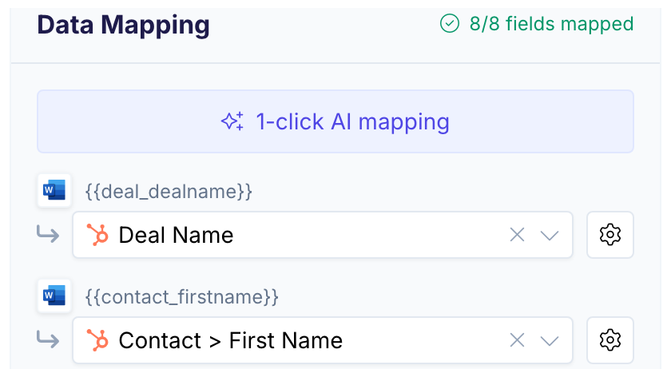
</Frame>

5. Pick a record in the record picker and click **Preview** to check the document.

<Frame>
  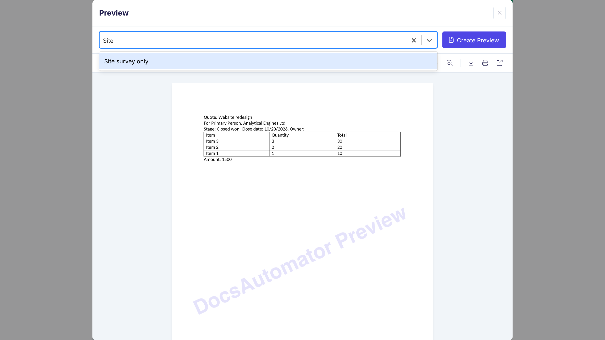
</Frame>

## Create a document from the record

Add the DocsAutomator card to your records:

1. In HubSpot, open **Settings**, **Integrations**, **Connected apps**, **DocsAutomator**, then the **Settings** tab and **App cards**.

   <Frame>
     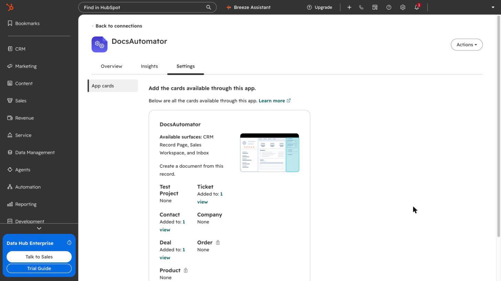
   </Frame>

2. Find DocsAutomator and click **Manage locations**.

   <Frame>
     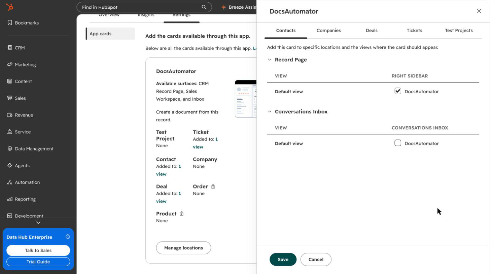
   </Frame>

3. On the tab of your record type, under **Record Page**, tick DocsAutomator in the **Right sidebar** column for **Default view**, then click **Save**.

   <Frame>
     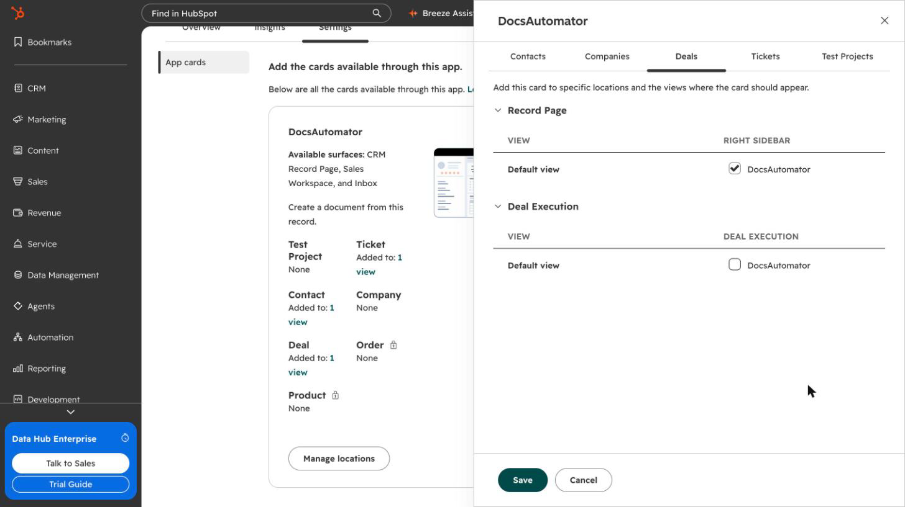
   </Frame>

4. HubSpot adds the card at the bottom of the right sidebar. To move it up, open a record, click **Customize**, drag DocsAutomator to the top of the right column, then click **Save and exit**.

   <Frame>
     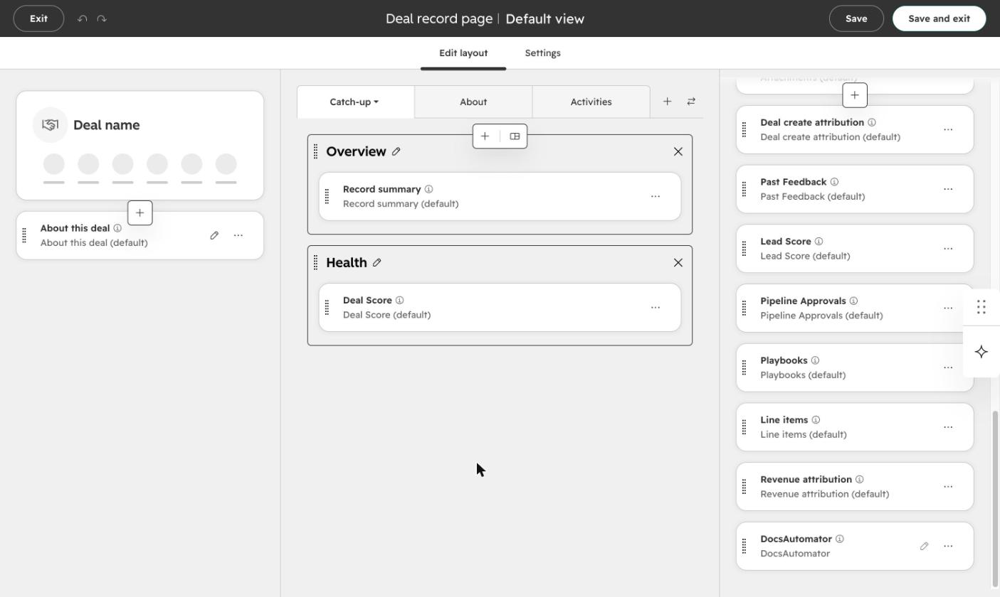
   </Frame>

Then open a record, choose the automation in the DocsAutomator card, and click **Create document**. When signing or acceptance is on, the button reads **Create and send**. The PDF appears on the record as a note, and the card links to it.

<Frame>
  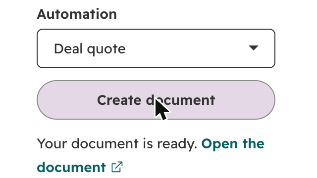
</Frame>

<Frame>
  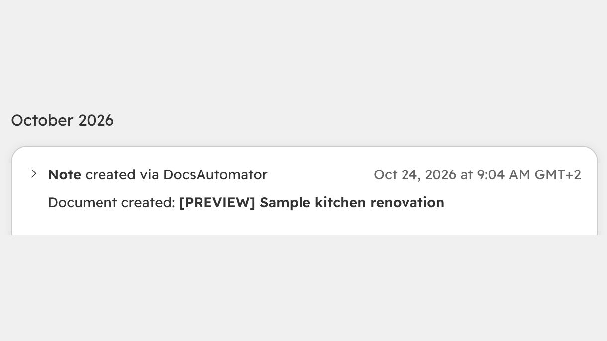
</Frame>

## Create documents in a workflow

1. In HubSpot, open **Automation**, then **Workflows**. Create a workflow for your record type, or open one you have.

   <Frame>
     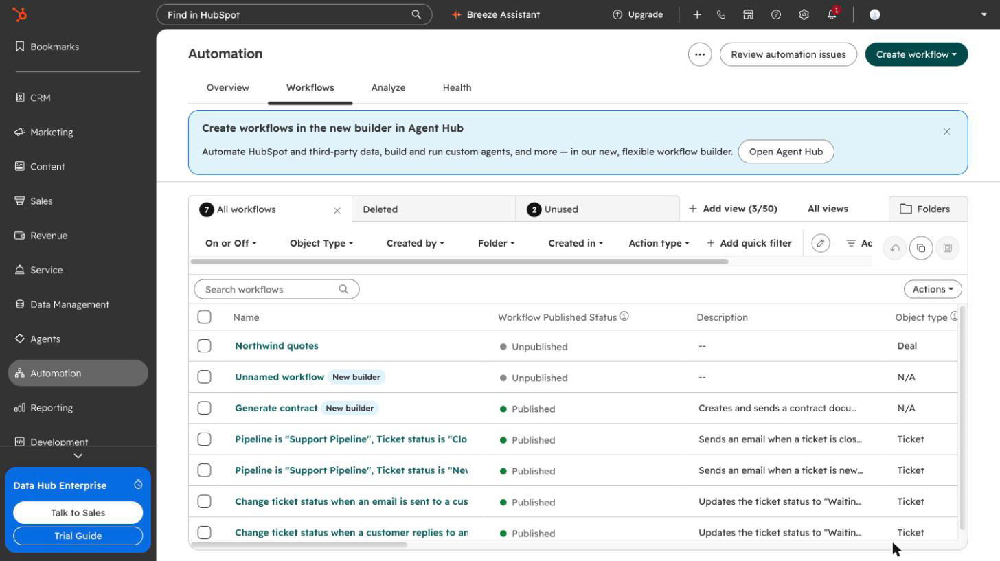
   </Frame>

2. Add an action, search for **Create document with DocsAutomator**, and choose it.

   <Frame>
     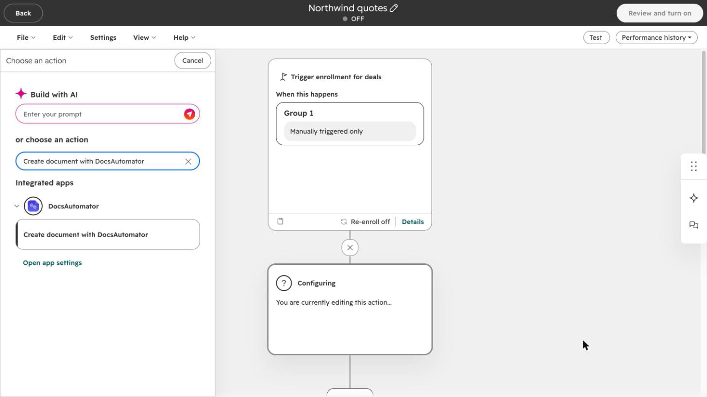
   </Frame>

3. Leave the target record on the enrolled record. Under **Automation**, choose your automation.

   <Frame>
     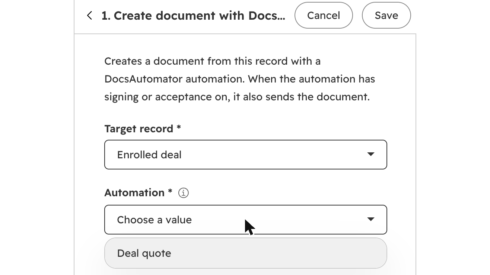
   </Frame>

4. Save the workflow and turn it on.

   <Frame>
     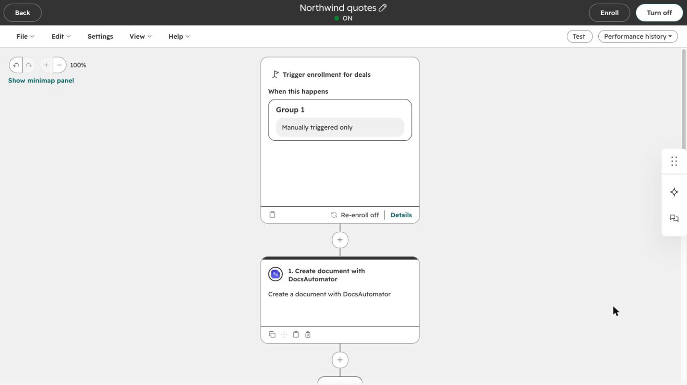
   </Frame>

Each run puts the PDF on the record as a note. Later steps can use these outputs:

| Output | Name in the action log | What it holds |
|---|---|---|
| Document link | `documentUrl` | The link to the PDF |
| Mode (test or live) | `mode` | `test` when the automation runs in test mode, otherwise `live` |
| Error code and Error message | `errorCode`, `errorMessage` | Why a run failed |

The workflow's **Action logs** show the outputs of each run under their names.

<Frame>
  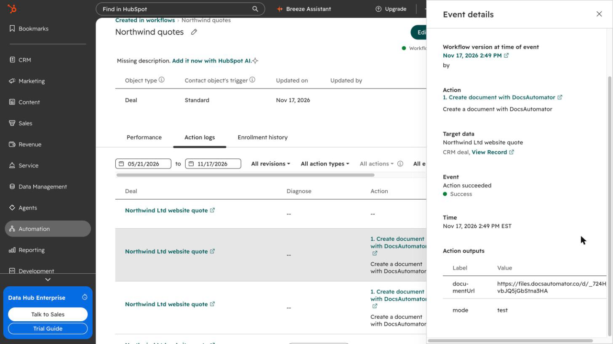
</Frame>

When a run fails, the workflow continues and its history shows the reason, for example that HubSpot needs to be reconnected.

## Signing and acceptance

- The signer is the record's primary contact by default. You can change it in the signing settings.
- After signing, the signed PDF comes back to the record as a second note.
- If a signer declines or the request expires, a note on the record says so.
- **After signing, move the deal to**: choose a stage for each pipeline. The default is to leave the deal where it is, because a won stage changes your revenue reports.
- A workflow step finishes when the document is sent, not when it is signed. To act on the signature, start a workflow on the new stage.

## Write back to properties

- **Save PDF URL to HubSpot** writes the document link into a property you choose.
- The status ("Sent for signing" or "Sent for acceptance", "Signed" or "Accepted", "Declined", "Expired") can go into a property you choose.

## When the connection stops working

DocsAutomator checks the HubSpot connection every day. If it stops working, the workspace owners get one email with a reconnect link, and the card shows **Reconnect DocsAutomator**. Runs fail with a reconnect message until you reconnect in **Settings**, **Integrations**.

<Frame>
  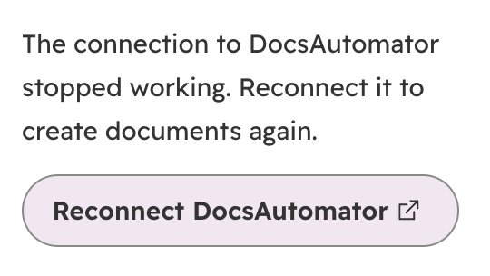
</Frame>

<Warning>
Reconnecting HubSpot reinstalls the app and removes the card from your records. Add the card again with the steps under "Create a document from the record".
</Warning>

## Disconnect or uninstall, and what happens to your data

<Frame>
  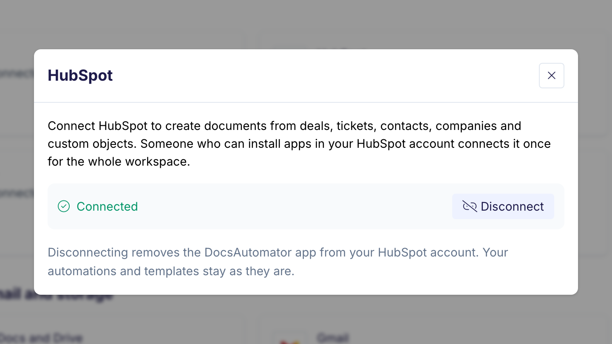
</Frame>

- **Disconnect in DocsAutomator** (Settings, Integrations): DocsAutomator removes the app and its cards from your HubSpot account and deletes the stored HubSpot tokens immediately.
- **Uninstall in HubSpot** (Settings, Integrations, Connected apps): the app stops working immediately. DocsAutomator marks the connection as broken and stops runs from HubSpot.
- **Data in HubSpot**: the notes and PDFs that DocsAutomator filed on your records stay in HubSpot. They belong to you.
- **Data in DocsAutomator**: your automations and templates stay, so you can reconnect later. Generated documents follow the expiry you set. After 90 days, the run log keeps the record id and the run details, not the record data. To delete your workspace or your account and its data, see [Delete your account and data](/account-billing/delete-account-and-data).
- What DocsAutomator stores and for how long is described in the [privacy policy](https://docsautomator.co/privacy-policy).

## Get help

Write to [support@docsautomator.co](mailto:support@docsautomator.co). Name the HubSpot record and the automation, so we can find the run. In the DocsAutomator app, you can also use **Contact support** in the sidebar.
