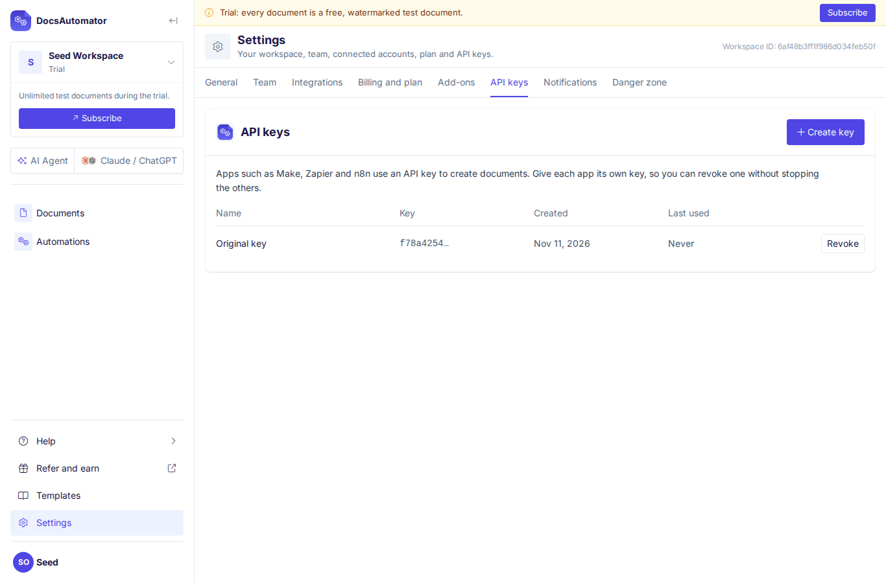

An API key is a secret code that lets an app create documents in your DocsAutomator workspace. Apps such as Make, Zapier, n8n, Glide, Softr and Noloco use a key, and so do your own scripts and the [DocsAutomator API](/api-reference/introduction).

API keys belong to the **workspace**, not to you as a person. A workspace can have several keys. Give each app its own key, so you can revoke one without stopping the others.

## Where to find your keys

Go to [Settings > API keys](https://app.docsautomator.co/settings/workspace/api). The page lists every key in the workspace with:

- **Name**: the name you gave the key, for example "Make" or "Zapier: Invoices".
- **Key**: the first characters of the key, so you can tell keys apart. The full key is never shown here.
- **Created**: the day the key was made.
- **Last used**: the last day an app used the key, or "Never" if no app has used it yet. It updates at most once an hour.

<Frame caption="Settings > API keys">
  
</Frame>

If your workspace had an API key before named keys arrived, it shows as **Original key**. It keeps working until you revoke it. Its **Last used** column shows "Never" until someone in the workspace creates or revokes a key for the first time, even if apps use it. After that, it shows when an app uses it.

## Create a key

Workspace owners and admins can create keys.

1. Go to [Settings > API keys](https://app.docsautomator.co/settings/workspace/api) and click **Create key**.
2. The name field starts with a name such as "Key 2". Change it to the app that will use the key, for example "Make" or "Zapier". If the name is already taken, DocsAutomator adds a number, for example "Make 2".
3. Click **Create key**.
4. Click **Copy** and paste the key into your app.

<Warning>
The full key is shown once. The dialog says "Copy this key now. You will not see it again." We cannot show it again later. If you lose a key, create a new one and revoke the old one.
</Warning>

### Create a key from the setup guide

You can also create a key while you set up an automation. When a step in the automation's setup guide needs a key, it shows `YOUR_API_KEY` and a **Create a key for this** button. You see it for example in the steps for Make, Zapier, n8n, the Airtable automation script, the Notion button, ClickUp and SmartSuite Automations.

Click **Create a key for this**. DocsAutomator creates a key named after the app and the automation, for example "Make: Invoices", and fills it into the steps. Copy it before you leave the page, because you will not see it again after that.

<Info>
Google Sheets links and Airtable or SmartSuite button formulas need no key. The formula in the setup guide already contains a link that works for that one automation only. Copy the formula as it is.
</Info>

## Use a key

Send the key in the `Authorization` header, after the word `Bearer`:

```bash
curl -X POST "https://api.docsautomator.co/createDocument" \
  -H "Authorization: Bearer YOUR_API_KEY" \
  -H "Content-Type: application/json" \
  -d '{"docId": "...", "recId": "..."}'
```

Replace `YOUR_API_KEY` with your key. See the [API introduction](/api-reference/introduction) for full usage.

## Revoke a key

Revoke a key when an app no longer needs it, or when someone may have seen it who should not have.

1. Go to [Settings > API keys](https://app.docsautomator.co/settings/workspace/api).
2. Click **Revoke** next to the key.
3. Check the name and the first characters in the dialog, then click **Revoke**.

Apps that use this key stop working at once. Other keys keep working. You cannot undo a revoke.

## Replace a key

There is no way to change a key in place. To replace one without a break:

1. Create a new key, named after the same app.
2. Paste the new key into the app and check that the app still creates documents.
3. Revoke the old key.

The **Last used** column helps here. It updates at most once an hour, so wait until the old key's **Last used** day stops changing before you revoke it. An **Original key** shows "Never" until the first key is created or revoked in the workspace, so do not rely on its **Last used** column before then.

## Members

Only workspace owners and admins can create and revoke keys. Members see the list of keys without the **Create key** and **Revoke** buttons. In a setup guide, members see "Ask a workspace owner or admin for an API key."

## Keep your keys secret

Treat an API key like a password. Anyone who has the key can create documents in your workspace, and those documents count toward your plan.

- Do not share a key in email, chat or support tickets.
- Do not put a key in a public website, a public code repository or a spreadsheet other people can open.
- Give each app its own key, so you can revoke one without stopping the others.
- If a key may have leaked, create a new key for that app, then revoke the old one.
